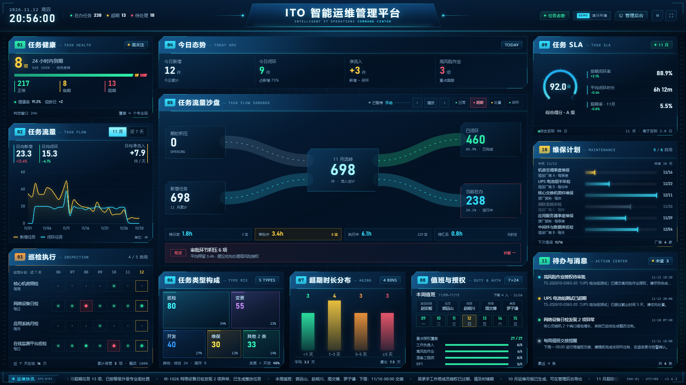
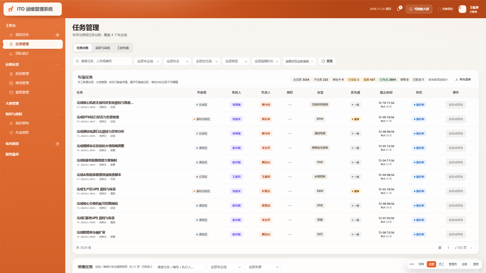

# ITO 智能运维管理平台 · 驾驶舱 + 管理后台

一套可直接运行的 ITO 运维产品原型：深色 **运维指挥中心大屏** 负责态势感知，浅色 **运维管理后台** 负责任务、人员、巡检、值班与配置管理。两端共享同一套演示数据口径，并可互相跳转。

纯前端实现，无构建步骤、无后端依赖、无 CDN 依赖。

## 在线演示

- 驾驶舱：<https://wwwxhhhkk.github.io/ito-ops-platform/>
- 管理后台：<https://wwwxhhhkk.github.io/ito-ops-platform/admin.html>
- 后台指定身份：<https://wwwxhhhkk.github.io/ito-ops-platform/admin.html?role=leader#/dispatch>

GitHub 仓库：<https://github.com/WWWXHHHKK/ito-ops-platform>


| 驾驶舱大屏 | 管理后台 |
| --- | --- |
|  |  |
| `index.html` · 1920 × 1080 固定画布 | `admin.html` · 流式工作台 · 1600+ |

## 运行

直接双击 `index.html` 或 `admin.html` 即可。若浏览器限制本地文件，可在项目目录启动静态服务：

```bash
python -m http.server 4173
```

| 入口 | 地址 |
| --- | --- |
| 驾驶舱实时版 | <http://127.0.0.1:4173/> |
| 驾驶舱静态截图版 | <http://127.0.0.1:4173/?still=1> |
| 管理后台 · 身份选择 | <http://127.0.0.1:4173/admin.html?login=1> |
| 管理后台 · 普通入口 | <http://127.0.0.1:4173/admin.html> |
| 后台指定身份（截图用） | <http://127.0.0.1:4173/admin.html?role=leader&still=1> |
| 后台指定页面 | <http://127.0.0.1:4173/admin.html?role=manager#/dispatch> |

`role` 可取 `leader` / `manager` / `employee` / `admin`。`?role=` 会跳过登录页直接进入指定身份；`?login=1` 会强制回到身份选择页。正常演示从登录页选择身份即可，登录后也可点左下角「切换身份」返回。演示时使用 `?dev=1` 打开右下角 DEV 切换器，例如 <http://127.0.0.1:4173/admin.html?dev=1&demo=2026-12-01#/tasks>；DEV 切换保留当前页面，登录页选择角色进入对应默认页。

## 数据与重置

- 后台数据默认保存在当前浏览器 `localStorage`，刷新页面不会回到初始快照。
- 登录页提供「重置演示数据」，也可访问 `admin.html?reset=1` 清空本地快照并恢复初始演示数据。
- 成果物与附件文件优先写入 IndexedDB；浏览器限制 IndexedDB 时自动降级为内存演示模式，页面主流程不受影响。
- 表单取消或关闭时会清理本次新上传但未保存的临时附件；保存时保留已提交附件并清理被移除附件。
- 接入真实接口时替换 `assets/js/ito-data-source.js` 中的数据源适配器即可，不改变页面结构。
- 驾驶舱打开时读取后台 `ito.ops.demo.snapshot.v1` 本地快照：站内消息、巡检异常合计、维保计划与厂商数每 10 秒同步；值班排班只在打开大屏时同步一次。任务流量、任务健康、今日态势、类型构成与 SLA 使用驾驶舱自身的 11 月口径。
- 驾驶舱 SLA 综合得分口径见 [`docs/SLA.md`](docs/SLA.md)。
- 无障碍审计范围、修复与残留风险见 [`docs/ACCESSIBILITY.md`](docs/ACCESSIBILITY.md)。

> 当前发布约定：先在本地 `http://127.0.0.1:4173` 预览并确认，确认后再部署到 GitHub Pages；未确认的改动不自动上传。

## 驾驶舱模块

| 区域 | 内容 |
| --- | --- |
| 顶栏 | 日期时钟、在办 238 / 超期 13 / 待处理 18、中央标题舱、任务态势、演示环境、管理后台入口、暂停、全屏 |
| 任务健康 | 临期 8 / 正常 217 / 超期 13，健康率 91.2%，分段状态带 |
| 任务流量 | 11 月 / 近 7 天切换、日均新增 23.3 / 日均闭环 15.3 / 日均净流入 +7.9 双趋势 |
| 巡检执行 | 4 个启用计划 × 近 7 天执行矩阵，近 7 天应检 16 次；累计异常 3 项（读取后台巡检记录合计） |
| 今日态势 | 今日新增 12 / 闭环 9 / 净流入 +3 / 高风险作业 3 |
| 任务流量沙盘 | 期初 0 + 新增 698 = 698，闭环 460 + 在办 238 = 698；流动光带与节点下钻 |
| 任务类型构成 | 巡检 80 / 变更 55 / 开发 40 / 维保 30 / 其他 33，切片树图；数字与任务中心清单一致 |
| 超期时长分布 | 按当前超期任务动态分桶；11 月 13 项时 <1 天 3 / 1–3 天 4 / 3–5 天 3 / ≥5 天 3，平均 3.2 天、最长 7.5 天 |
| 值班与授权 | 本周值班人 + 通信助理 / 应急 / 线路 / 网络 / 桌面五角色矩阵、7 天值班周条、下周交接、重点授权覆盖 11/11（工作负责人 / 高风险 / 准备工程师 / RP1）；整块可下钻到指定值班周 |
| 演示控制 | 位于 05 沙盘头部，10 秒轮播：日常 → 超期 → 处置 → 闭环，支持暂停 / 上一步 / 下一步 / 直接切状态 |
| 下钻 | 顶栏、01、02、04、06、07、08、09、10、11 可跳转任务中心、派发与审批、巡检、维保、值班、授权、消息 |
| 任务 SLA | 自绘 270° 仪表盘、SLA 92.0 分 / A 级、按期闭环 88.9%、平均闭环 6h12m、超期率 5.5%（11 月） |
| 维保计划 | 未来 30 天 6 项甘特排期、5 / 6 启用、4 家协同厂商、下次维保与最近维保 |
| 待办与消息 | 未读数 / 消息总数与后台站内消息一致，显示最近 4 条；审批、超期、巡检、值班消息 |
| 底部快讯 | 任务超期、巡检异常、值班交接、授权到期、月报生成 |

## 管理后台模块

| 模块 | 内容 |
| --- | --- |
| 登录 / 身份 | 领导层、主管层、员工层、系统管理员四种演示身份，不同菜单与操作权限；本地右下角 DEV 切换器可切到全局管理员 |
| 顶栏 | 全宽暖橙渐变顶栏，左侧白色品牌卡 + 德梵科技 Logo；侧栏从顶栏下方开始，浅橙色 |
| Logo | `assets/img/logo-mark-orange.svg`，登录页同款；白色版备用 |
| 任务管理 | 任务台账 / 派发与审批 / 工时负载三个页签，常规任务（巡检 / 维保 / 值班班次）并入台账同页展示，另有 `#/regular` 独立路由；不拆分 / 拆分两种创建模式、草稿筛选、超期视图、居中详情、成果物上传与在线预览、任务编辑 / 员工成果物编辑、改派执行人、取消任务、导出 CSV；任务详情支持补录工时、更新进度、直接闭环与执行任务级扩展字段；新建字段默认留空，负责人只选主管 / 组长，来源按发起人自动判断；「新建任务」在派发与审批页签 |
| 全生命周期 | 草稿 → 待分发 → 执行中 → 审批中 → 已完成；审批驳回退回执行中，超 72 小时变已挂起，可重新提交；领导下发任务闭环后进入待汇总、领导审批 |
| 派发与审批 | 作为任务管理页签；待派发 / 待审批两队列（待审批合并负责人审批、领导审批、汇总报审，按类型分块）；派发后进入执行中 |
| 我的任务 | 员工只看被分配的任务与常规任务；主管 / 领导额外显示我管理的任务与我执行的任务；顶部为「个人闭环趋势 + 四张 KPI」组合，趋势在左、KPI 在右纵向排列；不再展示属性勋章与授权；KPI 与趋势月份均可点击下钻任务列表，「团队 / 本组 / 我的工时消耗」展示成员实际工时流水与预算对比；值班任务并入常规任务 / 我的任务列表，不再单独显示值班交接块 |
| 个人统计 / 运营统计 / 团队统计 | 统计 / 月报两个标签页；标签卡只显示名称 + 星级 / 「授权」 / 任务完成次数，内容居中且等高，点击打开详情（累计次数、首次领取等只放在详情）；月报页内直接预览，支持我的 / 专业组 / 组员 / 员工 / 我发起，领导端为个人 / 专业组 / 员工；员工月报支持专业组筛选与可搜索人员选择器，主管组员月报只列本组；下载前先预览 |
| 巡检管理 | 计划启用 / 停用、新建 / 编辑、执行巡检、计划与记录居中详情、执行人与标准工时、异常继续生成整改主任务、记录实际工时、导出；新建字段默认留空、负责人只选主管 / 组长、执行人可选本组全员 |
| 维保管理 | 维保计划、厂商、周期顺延、执行人 / 标准工时、登记维保记录、计划与记录居中详情、导出 |
| 值班管理 | 周值班表：周次 / 日期范围 / 应急 / 线路 / 网络 / 桌面 / 出勤 / 状态；通信组 4 个角色按周轮换，通信助理赵宏毅固定为联系人；值班作为常规任务，待命不计工时，出勤按天 8h；详情保持 Excel 式 6 行值班表，默认只读，仅通信助理本人、领导与全局管理员可编辑；驾驶舱值班面板支持下钻到指定周 |
| 常规任务 | 巡检 / 维保计划按执行人同步到我的任务；提交记录后推进下一周期并生成下一期，异常巡检仍单独生成整改主任务 |
| 工时负载 | 周容量 40h、月容量 160h；负荷 = 周期内已记录实际工时 + 剩余计划工时 + 值班工时（8h/天）；初始工时由固定种子生成，演示数据按 40 人铺满，当前周负载约 55%–101%、月负载约 57%–104%，保留 2 人超载；提交 / 重新提交成果物与任务详情「补录工时」可登记本次投入，更新进度可按进度折算工时，直接闭环按实际投入补记并写入流水；已完成任务不再计入剩余负荷；新建 / 拆分 / 派发 / 改派选人时展示本周负荷、剩余工时与授权匹配，超过 100% 或缺少授权时提示并由主管确认继续 |
| 组织架构 | 整体满配 50 / 目前 40（80%）；4 个专业组各 10 人；成员档案含能力标签、属性勋章、作业授权和操作记录 |
| 作业授权 | 12 列只读矩阵（值班 / 入厂 / 基本安全培训 + 工作负责人 / 准备工程师 / 高风险 / RP1 / RP2 / 登高车 / 低压电工 / 高压电工 / 工具库）；满编 50 / 在册 40 / 计划 40 / 实际 40 / 可拿未拿 32 / 60 天临期 20 / 已过期 3；入厂授权与基本安全培训 40 人全员有效，作业授权台账 58 条（55 有效 / 3 过期）；状态由 `ITO.authStatus` 按演示日期统一计算（>60 天有效、≤60 天临期、过期）；实际授权自动关联同名属性勋章（有 / 无授权两态，过期即剔除、重新取得后恢复）；无续期 / 撤销 / 发放动作 |
| 站内消息 | 审批 / 超期 / 巡检 / 值班 / 通知，整卡点击进消息详情、未读筛选、全部已读、发送消息支持分组多选与人员多选；通知卡片去掉「查看详情」并放大字号；自定义通知不显示处理建议 |
| 审计留痕 | 任务、巡检计划、维保计划、组织成员、作业授权、属性勋章、预警规则均记录创建 / 最近更新 / 状态变更与操作人；授权详情可查看完整时间线 |
| 配置中心 | 默认仅系统管理员可见；字典配置（字典项 + 字段定义）已接入权限矩阵 `dictionary`，可由管理员开放给其他角色；另有预警规则（五类规则真实判定、30 分钟去重、立即检测、站内消息与日志留痕）、角色权限矩阵、操作日志 |
| 字典配置 | 左侧字典分类、右侧字典项表格；默认大修基地 A地区 / B地区，可新增 C地区 等并立即进入表单与筛选；支持编码、排序、启停；使用中数量按业务记录实时统计（人员类型 / 巡检周期 / 维保周期 / 维保厂商 / 任务状态 / 授权类型 / 值班状态 / 消息类型均已覆盖）；系统枚举只读，并明确标注配置位置：专业组→组织架构、任务状态→任务流转引擎、授权类型→作业授权矩阵、值班状态→值班排班、消息类型→站内消息；「字段定义」已开放大修行动 / 物资 / 人员、任务、巡检计划 / 记录、维保计划 / 记录、值班，可新增系统原本没有的字段并配置类型、字典来源、必填、校验、分组、列表 / 筛选 / 导出与可编辑角色，字段编码不可修改，停用后历史数据保留，并显示各字段已填写条数；任务字段区分主任务 / 执行任务，支持条件显示与依赖值，多选字段使用可搜索勾选组件，多选筛选可同时选择多个值；附件字段支持真实上传 / 下载 / 移除并在保存时清理存储，字段编辑支持实时效果预览，字段定义支持当前模块 / 全部模块 JSON 导入导出；字段值与附件元数据随本地快照持久化；预置设备位号、合同编号、变更单号、变更类型、紧急审批人、执行结果、点位编号、实测温度、更换部件、交接确认人等演示字段；列表型字段覆盖全部记录，详情型字段保留部分填写 |
| 属性勋章 | 一级菜单；左右两栏各 4 个/行；系统勋章字典；授权实际取得后自动关联同名标签，统一显示「授权」而非星级，不展示取得次数与首次领取时间，过期后剔除、重新取得后恢复；主管 / 领导 / 管理员可编辑，员工只读；改名 / 删除级联任务、子任务、人员成就与任务标签元数据 |
| 大修管理 | HZ101 大修专项行动：行动项 60 / 物资 42 / 人员矩阵按基地 + 专业组聚合 8 行（参考 Excel 13 行），含概览 KPI、行动项分析图表、三页签台账、搜索筛选、分页、详情、新增 / 编辑与真实 CSV 导出；员工可查看全部，但只能编辑本人行动项的描述 / 附件 / 进展、本人物资的采购进度 / 计划，人员矩阵只读，不能新增或导出；人员矩阵授权人数只读，点击可查看系统授权持有人明细；行动 / 物资 / 人员表单与详情自动追加自定义字段 |
| 导出 | 任务、巡检、维保、授权、日志、月报、值班表全部先预览再下载 |
| 本地调试 | 右下角 DEV 切换器：领导 / 主管 / 员工 / 管理员 / 全局；仅在 `localhost`、`127.0.0.1`、`::1` 或 `?dev=1` 显示；切换时保留当前页面、查询参数、分页与滚动位置，无权限时回默认页并提示；登录页选择角色进入对应默认页；全局管理员可见并可操作全部模块 |

### 中间列方案对照

`prototypes/center-full-options.html` 提供三套完整中间列编排：

- **A 业务运行态**：核心业务链路 + 漏斗 + 风险影响
- **B 故障演练**：事件指挥 + 故障影响面 + 处置时间线
- **C 数字孪生**：分层架构 + 容量水位 + 关键依赖

三套都支持 10 秒自动轮播，点击状态即暂停；可手动播放/暂停、上一步/下一步、直接切状态。

在线预览：<https://wwwxhhhkk.github.io/ito-ops-platform/prototypes/center-full-options.html#a>

### 展会版中间列

`prototypes/exhibition-center-options.html` 是面向客户展台的版本，不使用 API 网关 / 数据中台 / CMDB 等外部系统口径，全部改为平台自己的任务与专业组数据：

- **A 任务流转**：待派发 → 待审批 → 待接收 → 执行中 → 闭环
- **B 超期处置**：UPS 电池组测试超期 → 升级 → 授权 → 闭环
- **C 专业组孪生**：4 个专业组负荷、超期分布、值班与授权

同样支持 10 秒自动轮播和人工暂停 / 上一步 / 下一步 / 状态切换。

在线预览：<https://wwwxhhhkk.github.io/ito-ops-platform/prototypes/exhibition-center-options.html#a>

## 演示数据口径

- 任务库共 **3,524** 条主任务，覆盖 2026-07 至 2026-11：682 / 718 / 704 / 722 / 698；编号统一为 `TS-YYYYMM-####`，列表按 11 月→7 月倒序、每页 10 条。
- 驾驶舱只统计 2026 年 11 月 **698** 条：在办 **238** = 期初积压 **0** + 新增 **698** − 已闭环 **460**。
- 11 月专业组在办：应用 **64** + 通信 **75** + 在线 **39** + 基础设施 **60** = **238**；超期 **13**、24 小时内到期 **8**、正常 **217**。
- 任务 SLA **92.0 分 / A 级**；按期闭环率 **88.9%**；平均闭环 **6h 12m**；超期率 **5.5%**。
- 现有 **128** 条历史任务保留在 10 月，不计入驾驶舱；子任务仍为 **222** 条；40 名成员，每组 10 人；**数据日期与演示时间自动跟随系统**；`?demo=YYYY-MM-DD` 回归时快照时间固定 **20:56**（内部口径，界面不展示）。
- 任务截止、完成时间、消息、日志、值班、巡检、授权有效期都会随日期整体平移；未完成超期数量随当前演示时间实时判断。
- 可用 `?demo=2026-11-11` 固定演示日做回归，例如 `admin.html?role=manager&demo=2026-11-11#/tasks`。
- 新增任务、闭环任务会同步更新在办、专业组分布、趋势与月度口径，避免数字互相矛盾。

完整契约见 [`docs/ADMIN.md`](docs/ADMIN.md)。

## 品牌壳层与通知

- 顶栏为全宽暖橙渐变：`#E0713A → #D75F27 → #D05A23 → #C2501C → #B44617`，右侧收深保证白字可读；侧栏从顶栏下方开始，使用 `#E5743B → #DE6A30 → #D46029` 纵向渐变。
- 白色 Logo 卡位于顶栏左侧 258px 品牌区，230 × 52px，左边距 14px、上下居中；不跨入侧栏。
- 一级菜单统一 13px / 650、36px 高、无图标；分组头有右侧折叠箭头，独立模块无箭头；二级菜单 13px / 500、36px 高、左缩进 26px、图标 16.5px；去掉全宽分隔线，用 6–8px 留白区分层级；独立模块与二级菜单激活时均为白底胶囊 + 橙色左条，折叠分组保留当前所在提示。
- 右上角通知为白色卡片、橙色左条、6 秒自动收起；悬停暂停、可关闭、点击跳转。
- 进入界面时显示未读站内消息；派发、提交、审批、驳回、汇总、领导审批、改派、取消会向对应人员排队推送，切换身份后补弹。
- Logo 当前为橙色 ITO 图形标 + 深色「ITO 运维管理系统」字标；拿到最终源文件后只替换 `assets/img/logo-mark-orange.svg`，不改布局。

## 成果物与在线预览

- 提交成果物、重新提交、领导汇总都要求**至少 1 个新文件**；员工编辑已提交成果物可保留已有文件、追加或移除文件。
- 任务中心列表提供「查看成果物」快捷入口，可直接打开该任务成果物清单；没有成果物时按钮置灰并提示“暂无成果物”。预览层位于任务详情和清单之上，关闭后回到原界面。
- 任务列表操作列统一为「编辑 / 查看成果物」，不固定在右侧，表头与按钮左对齐；点击任务行进入详情。派发、负责人审批、领导审批、汇总报审统一在「派发与审批」页处理。
- 领导层、主管层的「编辑」编辑任务信息，不可编辑状态置灰；员工层的「编辑」编辑本人已提交成果物，审批中 / 已挂起 / 执行中保存后重置审批计时，已完成保存为补充版本、不重新审批。
- 任务列表、任务详情、我的任务、提交弹窗、审批弹窗、CSV 与月报均不展示进度字段。
- 前端验收版使用 **IndexedDB** 保存文件，刷新、关页面后仍在；清除站点数据会丢失。
- 支持 PDF、图片、文本、CSV、JSON、Markdown、视频、音频、DOCX、XLSX、PPTX、ZIP 在线预览；未知格式降级下载。
- Office 预览使用本地 `docx-preview`、SheetJS、`pptx-preview`，不依赖外部 CDN。
- 预置样例位于 `assets/samples/deliverables/`，首次加载自动写入 IndexedDB，覆盖 6 种格式。
- 接后端后只替换存储层，改为对象存储、签名 URL 与真实权限校验。

## 数据字典

- 标签字典：[`docs/TAGS.md`](docs/TAGS.md) —— 3 层、8 个前缀、200 个标签；机器可读版 [`docs/tags.csv`](docs/tags.csv)。
- 指标字典：[`docs/METRICS.md`](docs/METRICS.md) —— 5 层、13 个域、200 个指标，含公式、当前值、状态码、内部复盘清单与冲突处置；机器可读版 [`docs/metrics.csv`](docs/metrics.csv)。
- 指标状态码：`P` 页面/文档展示、`C` 前端计算、`G` 建议新增、`D` 历史下线。当前快照为 `P` 14 / `C` 132 / `G` 31 / `D` 23。

## 技术说明

- 原生 HTML / CSS / JavaScript，无框架、无构建。
- 图表使用本地 `vendor/echarts.min.js`（ECharts 5.5.1），可离线运行。
- 成果物预览使用本地 `vendor/docx-preview.min.js`、`xlsx.full.min.js`、`pptx-preview.umd.js`、`jszip.min.js`；文件存 IndexedDB，不依赖外部 CDN。
- 驾驶舱固定 1920 × 1080，通过 `transform: scale()` 等比缩放居中；后台为流式布局，适配 1600 以上桌面与窄屏侧边栏。
- 后台数据集中在 `assets/js/ito-data.js`；页面模块分为 `admin-pages-*.js`，核心壳层在 `admin.js`。
- 驾驶舱中心列使用同一份 `ito-data.js`，由 `center-demo.js` 渲染 11 月任务流量沙盘（0 + 698 = 698，460 + 238 = 698），10 秒轮播，支持人工暂停与切状态；顶栏全局暂停会同步冻结中心流动与轮播。
- 中心沙盘节点与侧栏指标支持点击下钻；后台通过 `#/tasks?status=超期`、`#/tasks?q=通信` 等深链自动应用筛选。
- 后台状态保存在浏览器内存中，刷新会回到初始快照；登录身份写入 `sessionStorage`。
- 所有导出均为浏览器本地生成 CSV 或 HTML，不依赖服务器。

## 角色权限

| 角色 | 可见模块 | 写入范围 |
| --- | --- | --- |
| 领导层 · 张维远 | 团队任务、任务管理、运营统计、巡检、维保、值班、大修、组织架构、授权、站内消息、属性勋章 | 领导审批；可编辑可编辑状态任务；授权只读 |
| 主管层 · 王振邦 | 我的任务、任务管理、团队统计、巡检、维保、值班、大修、组织架构、授权、站内消息、属性勋章 | 日常运营读写；可编辑可编辑状态任务；授权只读 |
| 员工层 · 赵明川 | 我的任务、个人统计、值班、大修、我的授权、站内消息、属性勋章（默认落地「我的任务」） | 仅本人任务执行与本人成果物编辑；大修可查看全部，仅本人行动项描述 / 附件 / 进展、本人物资进度 / 计划可编辑，不能新增 / 导出；人员矩阵只读；授权只读 |
| 系统管理员 | 组织架构、属性勋章、字典配置、预警规则、角色权限、操作日志（默认落地「字典配置」） | 配置中心、组织架构与审计；不提供大修管理与站内消息入口；字典项与字段定义可维护；不展示个人统计；属性勋章可维护 |

默认落地页：系统管理员进入「组织架构」，领导层、主管层、员工层、全局管理员均进入「我的任务」。

权限矩阵为 4 角色 × 10 模块 = 40 格，默认开放 26 格（65%）。可在「配置中心 → 角色权限」中调整；系统管理员列与领导层配置中心受保护。

## 目录

```text
.
├─ index.html                  # 深色驾驶舱
├─ admin.html                  # 浅色管理后台
├─ assets/
│  ├─ css/
│  │  ├─ style.css             # 驾驶舱设计系统
│  │  └─ admin.css             # 后台设计系统
│  ├─ js/
│     ├─ app.js                # 驾驶舱交互与模拟数据
│     ├─ platform-panels.js    # 驾驶舱左右列面板渲染
│     ├─ center-demo.js        # 中心列任务流量沙盘与轮播
│     ├─ ito-data.js           # 驾驶舱 / 后台共享业务数据
│     ├─ admin.js              # 后台壳层 / 登录 / 路由 / 弹层 / 图表
│     ├─ deliverable-store.js  # 成果物 IndexedDB、版本与工作流回放
│     ├─ deliverable-preview.js# 成果物在线预览与下载
│     └─ admin-pages-*.js      # 后台各业务页面
│  └─ samples/deliverables/    # PDF / 图片 / DOCX / XLSX / PPTX / ZIP 样例
├─ prototypes/                 # 中间列方案对照页
├─ archive/                    # 归档的旧版页面（admin-pages-auth.js，未接路由）
├─ vendor/                     # echarts + docx-preview + xlsx + pptx-preview + jszip
├─ docs/
│  ├─ HANDOFF.md               # 驾驶舱交接规范
│  ├─ ADMIN.md                 # 后台交接规范
│  ├─ TAGS.md / tags.csv       # 标签字典
│  ├─ METRICS.md / metrics.csv # 指标字典
│  ├─ USAGE.md
│  └─ AGENT_PROMPT.md
├─ AGENTS.md
├─ preview.png
├─ admin-preview.png
└─ README.md
```

## 后续接真实接口

1. 将 `assets/js/ito-data.js` 替换为接口返回的数据适配层，保持字段结构不变。
2. 任务、审批、巡检、值班、授权等写操作，在页面模块的提交回调中改为调用 API；成功后刷新对应 state。
3. 登录页替换为统一身份认证，用角色码映射 `permissions`。
4. 驾驶舱继续使用 WebSocket / SSE 推送实时事件；后台轮询或订阅任务变更。
5. 成果物从 IndexedDB 迁移到对象存储：上传换取 fileId，预览使用短时签名 URL，审批与下载走服务端鉴权。
5. 若接入 Vue / React，可沿用现有视觉令牌与页面结构逐模块迁移，不需要重做设计。

## Agent 交接

1. [`AGENTS.md`](AGENTS.md) — 项目级硬规则。
2. [`docs/HANDOFF.md`](docs/HANDOFF.md) — 大屏设计令牌、布局、模块与验收。
3. [`docs/ADMIN.md`](docs/ADMIN.md) — 后台结构、角色、数据与交互。
4. `preview.png` / `admin-preview.png` — 两端视觉基准。

一句话交接：

> 这是同一套 ITO 产品的两个视图：深色大屏负责态势，浅色后台负责管理。请保留两端各自的设计语言、互跳入口、共享数据口径和真实可用的交互，不要合并成一种风格，也不要退化成静态图。
